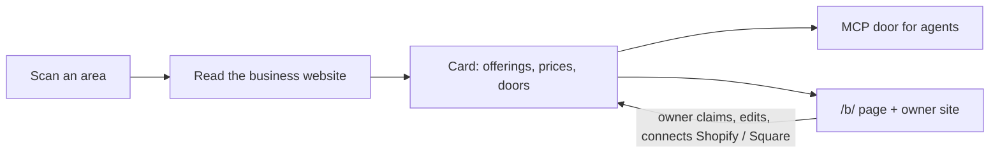

# Versum Agent Assistant


[](#60-second-quickstart)
[-green)](LICENSE)
[](#coverage)
[](https://toolsdk-ai.github.io/toolsdk-mcp-registry/#%40toolsdk-remote%2Fversum-agent-assistant)

AI agents can find a local business, see what it sells, check availability and price, and open a real order or booking.

## Why

Local businesses are close to invisible to AI agents. Their menus, price lists and booking pages are written for
people, an agent cannot phone the shop, and many businesses have no website an agent could use at all. Versum reads
what each business publishes, turns it into one card per business with real links to order, book or ask, and serves
the cards to any MCP client.

## 60-second quickstart

Two MCP doors, both streamable HTTP — no key, no account, no payment:

| door | |
|---|---|
| `https://versum.suverse.io/mcp/catalog` | the free business catalogue: the 15 tools below and nothing else (recommended) |
| `https://versum.suverse.io/mcp` | the same 15 tools for a client without a key (with a Versum node key it is the compute door) |

**Claude** — Customize → Connectors → **Add custom connector** → URL `https://versum.suverse.io/mcp/catalog` → Add.
No sign-in is asked for.

**ChatGPT** (plans with Developer mode) — turn on Developer mode in the connector settings, then **Create** a connector
with the MCP URL `https://versum.suverse.io/mcp/catalog` and no authentication. The menu names differ between ChatGPT
versions.

**Cursor** (`~/.cursor/mcp.json`) or any client that takes a JSON server list:

```json
{
  "mcpServers": {
    "versum": { "type": "http", "url": "https://versum.suverse.io/mcp/catalog" }
  }
}
```

Checked by connecting the official MCP TypeScript SDK client with exactly this entry: 15 tools listed, a live call
answered.

One request — `search_catalog` with `{"query": "a dozen red roses delivered", "location": "Miami, FL", "limit": 3}` —
and the live answer (2026-11-02), cut to the first business:

```json
{
  "found": 12,
  "returned": 3,
  "businesses": [
    {
      "id": "f2f197e1-7e39-4794-9e3c-54a77a75ef24",
      "name": "More Than Flowers",
      "trade": "Florist",
      "miles_away": 2.1,
      "offerings": [
        {
          "id": "e9a2aebb-cd9e-4627-8d8d-84d866a26bee",
          "title": "Three Dozen Roses - Hot Pink",
          "price": 135,
          "availability": "in_stock",
          "link": "https://morethanflowersmiami.com/miami-more-than-flowers/three-dozen-roses-hot-pink.html?ref=versum"
        }
      ],
      "can": ["check_delivery", "contact", "order"],
      "links": {
        "order": "https://morethanflowersmiami.com/miami-more-than-flowers/mayflower-wrapped-bouquet.html?ref=versum",
        "contact": "tel:+17865876195"
      }
    }
  ]
}
```

## Read any business website yourself

[`reader/`](reader) is Versum's own open reader: the same readers the catalogue runs, on your machine, for any
website — items with prices, the doors to order, book or ask, hours and contacts, every value with the words it was
read from. No Google, no proxy, no browser; robots.txt obeyed; a model only with your own `ANTHROPIC_API_KEY`
(`--no-model` turns it off).

```sh
cd reader && npm install && npm run build
node dist/cli.cjs read https://example-business.com --pretty
```

Its shared cache is free and on by default (`--no-share` or `VERSUM_SHARE=0` turns it off): what is sent and kept
is in [reader/README.md](reader/README.md#shared-cache--free-on-by-default) and the
[privacy policy](https://versum.suverse.io/privacy).

## How to search (for agents)

The server sends these rules to every client in its instructions; the short version:

1. **Turn the person's request into a business type and a place.** «I'm locked out of my car in Tampa» → `locksmith`,
   `Tampa`. «My AC is blowing warm air, 33618» → `hvac`, `33618`. You don't need the catalogue's internal niche keys:
   `list_niches` and `search_catalog` match ordinary words.
2. **Pick the tool:** you know the name → `find_business`; you know the type → `list_cards`; you don't, or you need a
   specific item («vegan pizza», «brake pads») → `search_catalog`.
3. **No place, no guess.** If the request has no city or ZIP, ask the person. The catalogue answers `location_needed`
   rather than picking a place for you.
4. **A result is a candidate.** Check the card: what it lists, whether it comes to the customer (`at_customer`:
   confirmed / confirmed not / unknown), the service area, the doors.
5. **Keep facts apart:** opening hours are not free time, an item price is not the final total, «nearby» is not «serves
   your area», no data is not «no».
6. **Next step through the right door:** menu or catalogue to look, `book` to book, `quote_order` for a total,
   `request_to_owner` to ask the owner (only where a channel is connected), otherwise the phone.
7. **Nothing on the person's behalf without their permission** — no requests, bookings, orders or payments.

Each result says why it matched (`match.basis`: a confirmed item, the business's own words, a category tag, or the
category only). When the catalogue cannot tell what kind of business a raw phrase needs, it says so and suggests close
types instead of returning look-alikes.

## Tools

| tool | what it does | main parameters |
|---|---|---|
| `list_niches` | the trades the catalogue knows near a place, with counts | `location`, `radius_miles`, `niche` |
| `list_cards` | every business of one trade near a place, in one fixed order (online niches: no location) | `niche`, `location` (required for local trades), `query`, `needed_by`, `max_price`, `deliver_to`, `page` |
| `find_business` | a business by its name | `name` (required), `location` |
| `search_catalog` | a match by meaning, when the trade is not known | `query` (required), `location`, `fulfillment`, `max_price`, `only_local` |
| `get_card` | one business in full: what it sells, what can be done, how it reaches you | `id` |
| `get_business` | synonym of `get_card` | `id` |
| `get_offering` | one thing in full, with its price checked again right now | `id` |
| `get_product` | synonym of `get_offering` | `id` |
| `quote_order` | what an order would cost delivered to an address — asked of the shop's own cart, nothing ordered | `offering_id`, `deliver_to` (required), `quantity`, `options` |
| `check_availability` | ask the business's own system: in stock now, which slots are free | `business_id`, `offering_id` (required), `from`, `to` |
| `place_order` | place an order in the business's own system; the buyer pays on the platform's checkout page | `business_id`, `lines` (required), `customer` |
| `book_slot` | book a slot in the business's own calendar (Square Appointments) | `business_id`, `offering_id`, `start_at`, `customer` (required) |
| `order_status` | what became of an order or a booking placed through this door | `order_id` |
| `request_to_owner` | send a request to the business's verified owner (Telegram, e-mail or WhatsApp) — not a booking until the owner confirms | `business_id`, `what`, `customer`, `idempotency_key` (required), `date`, `time`, `quantity`, `branch`, `note` |
| `request_status` | what became of a request: delivery (`sent` · `link_given` · `expired` · `failed`) and the owner's answer (`declined` · `other_time` · `available` = free but not booked · `confirmed` = booked) | `request_id` |

`check_availability`, `place_order` and `book_slot` work for businesses whose owner connected Shopify or Square
(the card shows `live_data`, and a `connected` door). Shopify: `place_order` returns the shop's own checkout link with
the items in the cart; the buyer gives their details and pays on Shopify. For every other business the card's doors
link to its own order and booking pages.

`request_to_owner` works for businesses whose owner claimed the card and connected a channel; for the others it
answers `no_channel` with the card's other doors. Retrying with the same `idempotency_key` never sends a second request.

### Example: `quote_order` — Flowers of Miami, 12 roses

`{"offering_id": "a05bbf1c-32c0-4a56-9038-310b0c35b852", "deliver_to": "1000 Brickell Ave, Miami, FL 33131"}` —
«Tiny Bouquet of 12 Red Roses with Baby Breath», live answer of 2026-11-02, from the shop's own cart:

| option the shop's cart offers | shipping | total |
|---|---:|---:|
| Local Delivery (picked first by the shop) | $20.00 | **$80.25** |
| Local Pickup | $0.00 | **$58.85** |

Item $55.00; the totals include the shop's own tax for this address. `placed: false` — nothing was ordered; only the
delivery address was sent (no name, e-mail or phone), and the cart session was emptied afterwards. `delivery_date` came back
`unknown`: the shop does not publish one through its cart.

## Online businesses

The catalogue holds every kind of business, not only local ones: software and apps, APIs and MCP servers, online
shops, open-source tools, content sites and marketplaces. Each card says what it is — **local**, **online**, or
**both** (a local business that also sells online; a local business with its own app stays local) — and why.

- An online card has no location. It shows «Online service», what it does, who it is for, pricing and plans, a free
  trial or plan, platforms, integrations / API / docs, support and the company — each read from the business's own
  pages with a quote.
- `list_niches` lists the online niches under `online_niches`.
- `list_cards` with an online niche ignores the location; `search_catalog` with no location and an online request
  (software, an app, an API…) returns online businesses — never `location_needed`.
- `get_card` adds an `online` block: every fact with the page it was read on.

## Only real businesses

Some «local businesses» are lead-generation sites: one company selling calls under several made-up names. Versum
checks for them and keeps them out:

- the same price list on several different websites, **and** their phones in the same block of numbers;
- no licence number on a site in a licensed trade;
- no owner, founding year or company named;
- the same site template and text across those sites.

A confirmed lead-generation card is never on the shelf — not in `search_catalog`, `list_cards` or `find_business`,
not in the sitemap — and its page answers 410. A card that only looks suspicious is reviewed by a person before
anything is hidden. The check runs every week.

## Publishing standard

Versum also publishes **independent pages** about some local businesses (`versum.suverse.io/offers/…`): written
only from the business's own public pages, re-checked the day they go live, marked as independent («did not ask for
it and did not pay for it, and is not a Versum client or partner»), with a way to have them corrected or removed.
Every page passes 18 checks before it is published. The rules are public:
**[Our Publishing Standards](https://versum.suverse.io/standards)**.

## Limits

| | |
|---|---|
| MCP doors, no key | no per-call limit today — please cache what you read |
| MCP with a Versum node key | the key's limit, returned in `x-ratelimit-limit` / `-remaining` / `-reset` |
| owner site: live card builds | no daily cap per address; 60 requests an hour per address |
| free check | 3 a day per website, 20 a day per address |

## The business card

`get_card` returns one card per business. The full schema, inferred from live cards of every kind of business, is
[`schema/card.schema.json`](schema/card.schema.json). The main parts:

- **identity** — `id`, `name`, `address`, `location`, `phone`, `email`, `website`, `hours` / `hours_folded`, `page_url`
- **offerings** — what it sells: each with `id`, `title`, `price`, `currency`, `availability`, `link`
- **actions** (the doors) — `order`, `book`, `reserve`, `request_quote`, `contact`, `check_delivery`; each with a real
  `url` (or `tel:` / `mailto:`) and the `provider` when it is a platform
- **fulfillment** — delivery, pickup and the rest, with what is known and what is not
- **reach** — how an agent can deal with the business, in one word:

  | reach | meaning |
  |---|---|
  | `online_platform` | orders or bookings go through a platform (a shop, ordering or booking system) |
  | `own_cart` | the business's own website takes the order |
  | `form_only` | a request form, no online order |
  | `phone_only` | the telephone is the only door |
  | `no_site` | the business has no website |
  | `not_read` | the site could not be read |

- **status** — `unverified`: read from the business's own public pages; the owner has not confirmed it. A business
  whose owner claimed and confirmed its card shows `owner_verified`. As of 2026-11-08 no business owner has verified
  a card yet: the only verified cards are Versum's own test businesses, which are not on the shelf.

## Transparency rating

Every card carries the public **Versum Transparency rating**: how much a buyer can know about the business *before
contacting it*, from what the business publishes about itself. It is **not** a rating of the quality of the work:
no stars, no reviews, no «best», and Versum never orders businesses by it on any page.

| item (local business) | counts when |
|---|---|
| Prices published | at least one price as text on the business's own pages |
| Licence shown | only trades that need a state licence (HVAC, plumbing, electrical, roofing, dentists…) |
| Hours | on the site, the Google Business Profile, or set by the verified owner |
| Service area / Address | the area served (trades that go to the customer), or a street address (places customers visit) |
| Phone or a booking / contact link | a tap-to-call number or a booking or contact link |
| Website read in the last 30 days | Versum read the site within 30 days |

Online businesses use their own list for each kind (software, API, shop, open source, content, marketplace), from the
same config as the free check. There is no «who it's for» item: the agent decides who a business fits; when the
business itself states its audience on its site, `get_card` gives it under `stated` with its source, never scored. Grade: **A** every item · **B** all but one · **C** half or more · **D** less than half.
Every ✓ links to the page it was found on and the date it was read. Method:
**[versum.suverse.io/transparency](https://versum.suverse.io/transparency)**.

For agents: `get_card` → `transparency` {grade, have, of, items with `source` and `read_at`, or `how_to_add`};
`list_cards` and `find_business` → `transparency` {grade, have, of, items: {key: true|false}} on each card. You may sort
or filter by it; the list order does not use it. In the card page's JSON-LD it is a plain `additionalProperty`
(`PropertyValue`, `propertyID: versum-transparency`), not a Review or AggregateRating.

## Taxonomy

Every card belongs to one or more niches (trades): a `key`, the words people use for it (`also_called`) and the
kinds of things it sells (`tags`). [`taxonomy/niches.json`](taxonomy/niches.json) lists the 128 niches as of
2026-11-02, read from `list_niches`; the live catalogue has 130 as of 2026-11-03.

## Coverage

| | |
|---|---:|
| cards on the shelf | 34,716 (live count: the badge above, or [/api/public/stats](https://versum.suverse.io/api/public/stats)) |
| niches | 136 |
| towns and neighborhoods | 87 |

As of 2026-11-08 (20:36 UTC). Scanning of new areas is paused; existing cards are kept and re-read.

| doors and prices (2026-11-08, out of 34,716 cards) | |
|---|---:|
| with an online order door | 2,773 |
| with an online booking or reservation door | 5,188 |
| with at least one price | 5,211 |

The densest coverage today is Tampa, St. Petersburg and the eastern Tampa Bay suburbs. Some places are still thin or empty — for example northern Pinellas (Clearwater, Dunedin, Palm Harbor) — and other Florida cities have far fewer cards so far. An empty result near such a place usually means the area is not scanned yet, not that no such business exists.

## For business owners

- **Free check: «What AI knows about your business»** — on [versum.suverse.io](https://versum.suverse.io), enter
  your website and get a score out of 100 by a published formula ([How we score](https://versum.suverse.io/how-we-score)):
  whether AI assistants name you (three buyer questions per niche and city, asked weekly through Claude with web
  search — the report names the engine and the date), which facts buyers look for are on your site, whether search and
  AI bots can read it, how you compare with businesses of your niche within 15 miles, and what to fix first. Every ✓
  links to the page it was found on. The full report adds every source and a ready LocalBusiness JSON-LD block and
  `llms.txt` built only from your own facts. Online businesses get their own formula by type (software, API / MCP,
  online shop, open source, content, marketplace), questions without a city made from the business's own description
  and audience (a marketplace is asked where to buy and sell, not which software to use), and SoftwareApplication /
  Organization code. If the address you enter is an app or sign-in area (`app.…`, `dashboard.…`, `/login`), the public
  site of the same business is read too and the report says which pages were read. Reports are private (not indexed,
  not in the sitemap); the check is free with no daily limit for now. Google Maps, reviews and rankings are not part
  of the check.
- **Claim your card** on [versum.suverse.io](https://versum.suverse.io): find your business, confirm it is yours (a
  code to a contact already on your card or website, or Shopify / Square), then edit what the card says and publish
  it. Every card has a public page, for example
  [versum.suverse.io/b/flowers-of-miami-miami](https://versum.suverse.io/b/flowers-of-miami-miami).
- **Telegram bot «Versum for Business»** ([@VersumBusinessBot](https://t.me/VersumBusinessBot)): requests from
  customers and agents arrive there, with buttons to confirm, decline or reply.
- **Connect Shopify or Square** from the owner page: the card then shows the store's live items, prices and
  availability, and agents can place orders and (Square) book slots in the owner's own system.
- **Grow your business** (on the owner page, at `/grow` and in the bot with `/grow`): the next steps for your card,
  and **Start promotion** — independent pages built to the [Publishing Standards](https://versum.suverse.io/standards),
  each published only after it passes all 18 checks, marked as published at the owner's request. Free during the test
  period; open only to owners who verified their business.
- Coming soon: the Shopify App Store listing.

### Owner API and the owner's own site (2026-11-09)

Everything an owner does — on the web, in the Versum app (iPhone in TestFlight; Android next) or through an assistant — is one
JSON API: **`https://versum.suverse.io/api/owner/v1`** ([OpenAPI](https://versum.suverse.io/api/owner/v1/openapi.json)).
Sign in with an email code (a short-lived access token plus a refresh token). Signing in proves the contact only: a
business is managed after a claim verified through a contact the business itself publishes (its website or Google
listing), a file or tag on its own website, or a person's review of a document — or when the owner added it.

- **Add a business without a website:** name and description in the owner's own words → duplicate check (a strong match
  means «claim it», a similar name is only a suggestion) → niche → the niche's fields → live, marked «from the owner».
- **Weak website:** the cabinet shows the Transparency grade and exactly what to add; «Improve my own website» gives
  JSON-LD, llms.txt and ready text for what the site is missing, and can create DRAFT pages on the owner's WordPress.
- **The owner's own Versum site** (`versum.suverse.io/s/<name>`): only after the owner turns it on; it shows only
  owner-approved data; its look is settings only (colours with contrast checks, font, layout, sections) — no custom code.

- **No sign-in to look around (2026-11-10):** the Versum app opens like the website. Public, token-less doors:
  `GET public/search?q=` (a business by name and city), `GET public/businesses/{id}` (the read-only view: Transparency
  grade, the AI check score and how often AI named the business, key facts — only what the public card shows),
  `POST public/build` (build a card live when it is not found), and «This is my business»: `GET|POST
  public/businesses/{id}/claim` sends a code to an email the business itself lists; `POST public/claims/{id}/verify`
  with the right code makes that contact the manager and signs it in. Limits per connection; 3 codes an hour per business.
- **Connect to Claude / ChatGPT:** `POST businesses/{id}/mcp-key` gives the owner a personal MCP address for their own
  card (shown once; a new one turns the old one off).

Agents keep reading the same cards through MCP; nothing here changes the tools below.

## How it works

1. A scan lists the businesses of a trade in an area.
2. The analyzer reads each business's own website: menus, price lists, shop catalogues, booking and ordering pages.
3. Everything it keeps carries the page and the words it was read from; nothing is invented.
4. One card per business goes on the shelf, with real doors.
5. Agents ask the MCP door; owners can claim, correct and connect their card.



## Listed in

- [Official MCP Registry](https://registry.modelcontextprotocol.io/v0/servers?search=io.suverse.versum) — `io.suverse.versum/catalog` (the earlier entry `io.github.sudzikcoin/versum-agent-assistant` is marked deprecated and points to it)
- [mcptry](https://mcptry.com/servers/io.suverse.versum/catalog) ([second entry](https://mcptry.com/servers/io.github.sudzikcoin/versum-agent-assistant))
- [Glama](https://glama.ai/mcp/servers/sudzikcoin/versum-agent-assistant)
- [mcpub.dev](https://mcpub.dev)
- [wellknown.network](https://wellknown.network/agents/versum-agent-assistant)
- [ToolSDK MCP Registry](https://toolsdk-ai.github.io/toolsdk-mcp-registry/#%40toolsdk-remote%2Fversum-agent-assistant)

## Roadmap

Done:
- The open reader with a shared cache: [`reader/`](reader).
- The catalogue-only MCP door `/mcp/catalog` (15 tools, no key).
- Owner claims, Shopify and Square connections, requests to owners through Telegram.
- The lead-generation filter.
- Independent promotion pages and the public [Publishing Standards](https://versum.suverse.io/standards).
- The free «What AI knows about your business» check for owners.

Next:
- Publish the npm package `@suverselabs/versum-mcp` (stdio, typed functions for the tools); its source is in [`npm/`](npm).
- WhatsApp click-to-chat doors.
- Scanning more areas (paused today).

## License and contact

MIT for the schemas, the taxonomy, the documentation and the open reader (`reader/`) in this repository; the hosted
catalogue's service code is closed.
[Privacy Policy](https://versum.suverse.io/privacy) · [Terms of Service](https://versum.suverse.io/terms) · [Publishing Standards](https://versum.suverse.io/standards) · [How we score](https://versum.suverse.io/how-we-score) (SuVerse LLC).
Contact: info@suverse.io. The compute side of Versum is [versum-node](https://github.com/sudzikcoin/versum-node).
