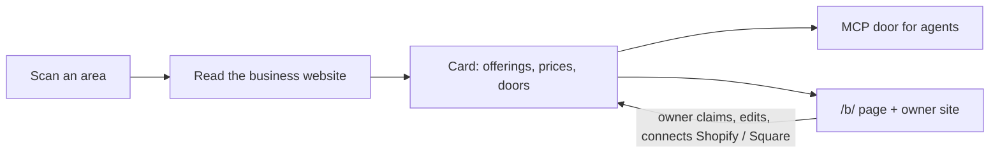

# Versum Agent Assistant


[](#60-second-quickstart)
[-green)](LICENSE)
[](#coverage)
[](https://toolsdk-ai.github.io/toolsdk-mcp-registry/#%40toolsdk-remote%2Fversum-agent-assistant)

AI agents can find a local business, see what it sells, check availability and price, and open a real order or booking.

## Why

Local businesses are close to invisible to AI agents. Their menus, price lists and booking pages are written for
people, an agent cannot phone the shop, and many businesses have no website an agent could use at all. Versum reads
what each business publishes, turns it into one card per business with real links to order, book or ask, and serves
the cards to any MCP client.

## 60-second quickstart

The MCP door (streamable HTTP, no key needed):

```
https://versum.suverse.io/mcp
```

Config for an MCP client that takes a JSON server list with streamable-HTTP servers (checked by connecting the
official MCP TypeScript SDK client with exactly this entry: 15 tools listed, a live call answered):

```json
{
  "mcpServers": {
    "versum": { "type": "http", "url": "https://versum.suverse.io/mcp" }
  }
}
```

One request — `search_catalog` with `{"query": "a dozen red roses delivered", "location": "Miami, FL", "limit": 3}` —
and the live answer (2026-11-02), cut to the first business:

```json
{
  "found": 12,
  "returned": 3,
  "businesses": [
    {
      "id": "f2f197e1-7e39-4794-9e3c-54a77a75ef24",
      "name": "More Than Flowers",
      "trade": "Florist",
      "miles_away": 2.1,
      "offerings": [
        {
          "id": "e9a2aebb-cd9e-4627-8d8d-84d866a26bee",
          "title": "Three Dozen Roses - Hot Pink",
          "price": 135,
          "availability": "in_stock",
          "link": "https://morethanflowersmiami.com/miami-more-than-flowers/three-dozen-roses-hot-pink.html?ref=versum"
        }
      ],
      "can": ["check_delivery", "contact", "order"],
      "links": {
        "order": "https://morethanflowersmiami.com/miami-more-than-flowers/mayflower-wrapped-bouquet.html?ref=versum",
        "contact": "tel:+17865876195"
      }
    }
  ]
}
```

## Read any business website yourself

[`reader/`](reader) is Versum's own open reader: the same readers the catalogue runs, on your machine, for any
website — items with prices, the doors to order, book or ask, hours and contacts, every value with the words it was
read from. No Google, no proxy, no browser; robots.txt obeyed; a model only with your own `ANTHROPIC_API_KEY`
(`--no-model` turns it off).

```sh
cd reader && npm install && npm run build
node dist/cli.cjs read https://example-business.com --pretty
```

Its shared cache is free and on by default (`--no-share` or `VERSUM_SHARE=0` turns it off): what is sent and kept
is in [reader/README.md](reader/README.md#shared-cache--free-on-by-default) and the
[privacy policy](https://versum.suverse.io/privacy).

## Tools

| tool | what it does | main parameters |
|---|---|---|
| `list_niches` | the trades the catalogue knows near a place, with counts | `location`, `radius_miles`, `niche` |
| `list_cards` | every business of one trade near a place, in one fixed order | `niche`, `location` (required), `query`, `needed_by`, `max_price`, `deliver_to`, `page` |
| `find_business` | a business by its name | `name` (required), `location` |
| `search_catalog` | a match by meaning, when the trade is not known | `query` (required), `location`, `fulfillment`, `max_price`, `only_local` |
| `get_card` | one business in full: what it sells, what can be done, how it reaches you | `id` |
| `get_business` | synonym of `get_card` | `id` |
| `get_offering` | one thing in full, with its price checked again right now | `id` |
| `get_product` | synonym of `get_offering` | `id` |
| `quote_order` | what an order would cost delivered to an address — asked of the shop's own cart, nothing ordered | `offering_id`, `deliver_to` (required), `quantity`, `options` |
| `check_availability` | ask the business's own system: in stock now, which slots are free | `business_id`, `offering_id` (required), `from`, `to` |
| `place_order` | place an order in the business's own system; the buyer pays on the platform's checkout page | `business_id`, `lines` (required), `customer` |
| `book_slot` | book a slot in the business's own calendar (Square Appointments) | `business_id`, `offering_id`, `start_at`, `customer` (required) |
| `order_status` | what became of an order or a booking placed through this door | `order_id` |
| `request_to_owner` | send a request to the business's verified owner (Telegram, e-mail or WhatsApp) — not a booking until the owner confirms | `business_id`, `what`, `customer`, `idempotency_key` (required), `date`, `time`, `quantity`, `branch`, `note` |
| `request_status` | what became of a request: delivery (`sent` · `link_given` · `expired` · `failed`) and the owner's answer (`declined` · `other_time` · `available` = free but not booked · `confirmed` = booked) | `request_id` |

`check_availability`, `place_order` and `book_slot` work for businesses whose owner connected Shopify or Square
(the card shows `live_data`, and a `connected` door). Shopify: `place_order` returns the shop's own checkout link with
the items in the cart; the buyer gives their details and pays on Shopify. For every other business the card's doors
link to its own order and booking pages.

`request_to_owner` works for businesses whose owner claimed the card and connected a channel; for the others it
answers `no_channel` with the card's other doors. Retrying with the same `idempotency_key` never sends a second request.

### Example: `quote_order` — Flowers of Miami, 12 roses

`{"offering_id": "a05bbf1c-32c0-4a56-9038-310b0c35b852", "deliver_to": "1000 Brickell Ave, Miami, FL 33131"}` —
«Tiny Bouquet of 12 Red Roses with Baby Breath», live answer of 2026-11-02, from the shop's own cart:

| option the shop's cart offers | shipping | total |
|---|---:|---:|
| Local Delivery (picked first by the shop) | $20.00 | **$80.25** |
| Local Pickup | $0.00 | **$58.85** |

Item $55.00; the totals include the shop's own tax for this address. `placed: false` — nothing was ordered; only the
delivery address was sent (no name, e-mail or phone), and the cart session was emptied afterwards. `delivery_date` came back
`unknown`: the shop does not publish one through its cart.

## The business card

`get_card` returns one card per business. The full schema, inferred from live cards of every kind of business, is
[`schema/card.schema.json`](schema/card.schema.json). The main parts:

- **identity** — `id`, `name`, `address`, `location`, `phone`, `email`, `website`, `hours` / `hours_folded`, `page_url`
- **offerings** — what it sells: each with `id`, `title`, `price`, `currency`, `availability`, `link`
- **actions** (the doors) — `order`, `book`, `reserve`, `request_quote`, `contact`, `check_delivery`; each with a real
  `url` (or `tel:` / `mailto:`) and the `provider` when it is a platform
- **fulfillment** — delivery, pickup and the rest, with what is known and what is not
- **reach** — how an agent can deal with the business, in one word:

  | reach | meaning |
  |---|---|
  | `online_platform` | orders or bookings go through a platform (a shop, ordering or booking system) |
  | `own_cart` | the business's own website takes the order |
  | `form_only` | a request form, no online order |
  | `phone_only` | the telephone is the only door |
  | `no_site` | the business has no website |
  | `not_read` | the site could not be read |

- **status** — `unverified`: read from the business's own public pages; the owner has not confirmed it. A business
  whose owner claimed and confirmed its card shows `owner_verified`. An unclaimed card is one no owner has claimed yet
  — today, every card.

## Taxonomy

Every card belongs to one or more niches (trades): a `key`, the words people use for it (`also_called`) and the
kinds of things it sells (`tags`). [`taxonomy/niches.json`](taxonomy/niches.json) lists the 128 niches as of
2026-11-02, read from `list_niches`; the live catalogue has 130 as of 2026-11-03.

## Coverage

| | |
|---|---:|
| cards on the shelf | 8,337 |
| niches | 130 |
| towns and neighborhoods | 53 |

As of 2026-11-03.

| doors and prices (2026-11-02, out of 7,415 cards then) | |
|---|---:|
| with an online order door | 860 |
| with an online booking or reservation door | 1,055 |
| with prices | 1,045 |

The densest coverage today is the Tampa Bay area; other Florida cities have far fewer cards so far.

## For business owners

- **[versum.suverse.io](https://versum.suverse.io)** — find your business, claim it, edit what the card says and
  publish it.
- **`/b/{slug}`** — every card has a public page, for example
  [versum.suverse.io/b/flowers-of-miami-miami](https://versum.suverse.io/b/flowers-of-miami-miami).
- **Connect Shopify or Square** from the owner page: the card then shows the store's live items, prices and
  availability, and agents can place orders and (Square) book slots in the owner's own system.
- Coming soon: the Shopify App Store listing.

## How it works

1. A scan lists the businesses of a trade in an area.
2. The analyzer reads each business's own website: menus, price lists, shop catalogues, booking and ordering pages.
3. Everything it keeps carries the page and the words it was read from; nothing is invented.
4. One card per business goes on the shelf, with real doors.
5. Agents ask the MCP door; owners can claim, correct and connect their card.



## Listed in

- [ToolSDK MCP Registry](https://toolsdk-ai.github.io/toolsdk-mcp-registry/#%40toolsdk-remote%2Fversum-agent-assistant)

## Roadmap

Done:
- The open reader with a shared cache: [`reader/`](reader).

Next:
- Publish the npm package `@suverselabs/versum-mcp` (stdio, typed functions for the tools); its source is in [`npm/`](npm).
- Listings in more MCP catalogues.
- WhatsApp click-to-chat doors.

## License and contact

MIT for the schemas, the taxonomy, the documentation and the open reader (`reader/`) in this repository; the hosted
catalogue's service code is closed.
[Privacy Policy](https://versum.suverse.io/privacy) · [Terms of Service](https://versum.suverse.io/terms) (SuVerse LLC).
Contact: info@suverse.io. The compute side of Versum is [versum-node](https://github.com/sudzikcoin/versum-node).
